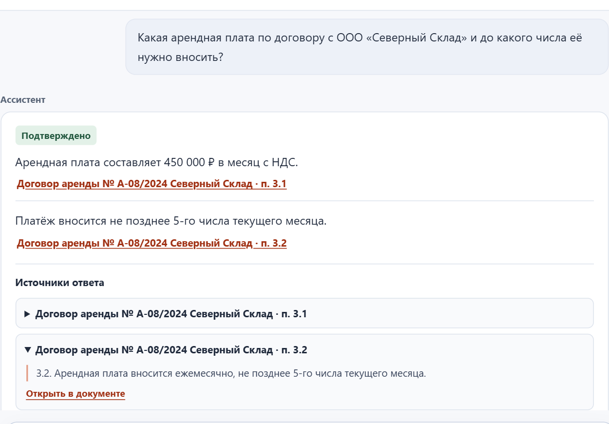
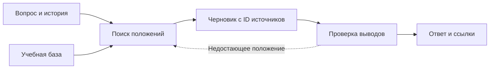

# Юридический ассистент ПСБ

**Hack&Change 2026 · AI-трек ПСБ · Первый тур**

Ассистент находит нужные положения в договорах, регламентах и нормативных выдержках. Он учитывает дату события и редакцию документа, показывает ссылку рядом с каждым подтверждённым выводом и открывает цитату в полном тексте.

[Скачать финальный проект](deliverables/PSB-final.zip) · [Презентация PDF](presentation.pdf) · [Исходный сабмит № 3](submissions/3.zip)

| Автоматическая оценка | Учебная база | Запуск |
| --- | --- | --- |
| **25,624 балла** у сабмита № 3, лучший результат команды по журналу отправок | **21 документ**, 797 фрагментов | **Docker Compose**. Поиск и просмотр документов доступны без ключа |



*Контрольный прогон с имитацией API. [Открыть скриншот полного документа с подсветкой цитаты](docs/images/document.png).*

## Быстрый запуск

```sh
git clone https://github.com/filipp880/Alfa-PSB.git
cd Alfa-PSB
docker compose up --build
```

Откройте [localhost:8000](http://localhost:8000). Спросите про срок внесения арендной платы по договору с ООО «Северный Склад». Раскройте найденный п. 3.2 и нажмите «Открыть в документе». База в `data/knowledge-base.zip` входит в проект.

Контейнер использует Python 3.12 и `rapidfuzz==3.14.1`. Порт `8000` доступен на `127.0.0.1`. Для запуска без Docker выполните из корня проекта:

```sh
python -m pip install -r requirements.txt
python web.py --offline
```

### Генерация ответов

Скопируйте [`.env.example`](.env.example) в `.env` и заполните настройки доступного OpenAI-совместимого прокси. Адрес должен быть доступен из контейнера. После изменения файла повторите `docker compose up --build`.

| Переменная | Что указать |
| --- | --- |
| `LLM_BASE_URL` | Базовый URL для `/chat/completions`. Добавьте `/v1`, если он входит в адрес API провайдера. |
| `LLM_API_KEY` | Токен прокси. На платформе автооценки его передавали организаторы. |
| `LLM_MODEL` | ID генеративной модели на прокси. На платформе использовалась DeepSeek V4.1 Flash. |
| `EMB_MODEL` | ID BGE-M3, если прокси поддерживает `/embeddings`. По умолчанию в Compose `off`. |
| `RERANKER_MODEL` | ID Qwen3 Reranker 8B, если прокси поддерживает `/rerank`. По умолчанию поле пустое. |
| `OFFLINE` | `1` включает локальный поиск. Он также включается автоматически, если данных для подключения к прокси недостаточно. |

При запуске через `python web.py` задайте переменные в окружении. Файл `.env` читает Docker Compose.

## Сценарии проверки

| Сценарий | Запрос | Что сверить в источнике |
| --- | --- | --- |
| Условия договора | Какая арендная плата по договору с ООО «Северный Склад» и до какого числа её нужно вносить? | Договор А-08/2024, п. 3.1 и 3.2. 450 000 ₽ в месяц с НДС, до 5-го числа текущего месяца включительно. |
| Продолжение диалога | А по нему какая пеня за просрочку? | Тот же договор, п. 5.1. 0,1% от задолженности за каждый день просрочки. |
| Смена применимого условия | Куда доставить товар по П-17/2024, если спецификацию подписали 1 октября 2024 года? Повторить для 2 октября. | 1 октября — Москва по п. 3.2, 2 октября — Химки по допсоглашению № 1. |
| Пробел в базе | Что предусмотрено в п. 9.9 договора А-08/2024? | Пункт отсутствует. Ожидается сообщение о недостатке сведений без ссылки на вымышленный пункт. |

В режиме без ключа можно проверить поиск положений, каталог и подсветку цитат. Ответы с выводами, уточнения и отказы проверяются с подключённой моделью.

## Архитектура



- [`corpus.py`](corpus.py) разбивает базу на статьи и пункты, извлекает реквизиты и даты, ищет связанные документы и определяет применимость редакций.
- [`assistant.py`](assistant.py) собирает контекст. Дополнительные настройки позволяют объединить лексический поиск и BGE-M3, затем применить Qwen3 для реранжирования. Код сверяет ID и берёт цитаты из корпуса. Отдельный запрос к модели проверяет смысл выводов. При конкретном пробеле возможен один повторный поиск.
- [`web.py`](web.py) обслуживает чат, каталог и просмотр документа. [`solution.py`](solution.py) запускает то же ядро для независимых вопросов в CSV. [`proxy.py`](proxy.py) отвечает за вызовы моделей.

## Автоматическая оценка

С подключённой моделью можно запустить пакетную проверку на 18 открытых вопросах организаторов:

```sh
python solution.py --questions examples/demo_questions.csv --output submission.csv
```

Выходной CSV в UTF-8 содержит колонки `id,answer`. Если вопрос содержит диалог, скрипт отвечает на последнюю реплику пользователя с учётом истории. Исходник из [`submissions/3.zip`](submissions/3.zip) совпадает с пакетными модулями проекта побайтно.

## Материалы репозитория

| Путь | Содержимое |
| --- | --- |
| [`deliverables/PSB-final.zip`](deliverables/PSB-final.zip) | Архив для экспертной оценки с кодом, базой, инструкцией и PDF |
| [`presentation.pdf`](presentation.pdf) | Восемь слайдов с порядком проверки, архитектурой и примерами |
| [`examples/`](examples/) | Демонстрационные вопросы организаторов |
| [`research/`](research/) | Снимок предыдущей версии с экспериментами, тестами и [журналом сабмитов](research/submissions/README.md) |

## Ограничения

Корпус учебный. Для исторического ответа нужен текст применимой редакции. Смысловая проверка зависит от качества поиска и модели, поэтому выводы могут содержать ошибки или пропуски. Формулировку и условия можно сверить в документе.
